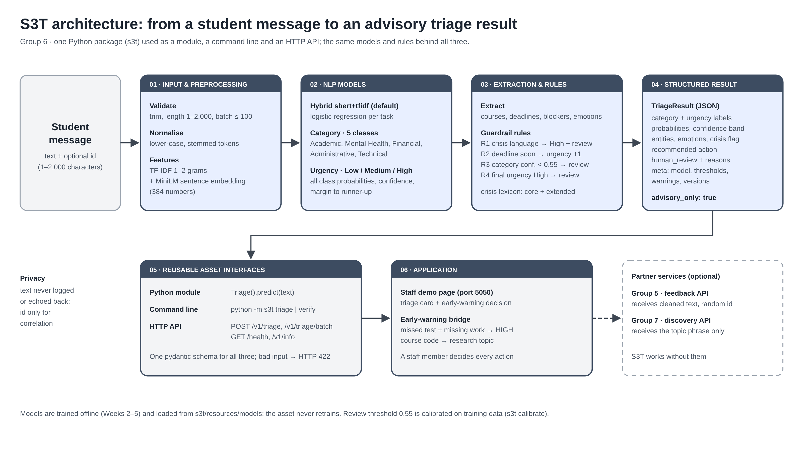

# S3T · Student Support Triage (Group 6)

**AI University · Speech and Natural Language Processing · Week 8 final project**

S3T reads a message a student sends to student support and returns, in under 10 ms:

- the **category** (Academic Difficulty, Mental Health & Wellbeing, Financial Aid, Administrative, Technical Support)
- the **urgency** (Low / Medium / High)
- **confidence scores** for both, with every class probability
- extracted **courses, deadlines, blockers and emotions**
- a **recommended action** and a **human-review flag** with reasons
- **crisis-language detection** that always sends the message to a person

It is **advisory only**: a staff member reads every result and makes every decision.



## Quick start (macOS / Linux, Python 3.9+)

```bash
git clone <this-repo-url>
cd <repo-folder>
./run_demo.sh
```

The first run creates `.venv` and installs S3T with the hybrid model (a few minutes; downloads a 90 MB
sentence encoder once). It then opens the demo page at **http://127.0.0.1:5050**. Ctrl+C stops it.
If you see "permission denied": `chmod +x run_demo.sh run_tests.sh`.

On the demo page, pick a sample email (**At-risk student**, **Routine query**, **Unknown course** …) and press
**Analyze**. Card 1 shows S3T's triage; card 3 shows the early-warning decision.

## Three ways to use it

```python
from s3t import Triage
r = Triage().predict("I can't log in to Canvas and my quiz is due today", id="ticket-001")
r.category.label, r.urgency.label, r.human_review.required
```

```bash
python -m s3t triage "My financial aid has not been disbursed"      # command line, JSON out
python -m s3t serve                                                  # HTTP API on :8000 (docs at /docs)
curl -s localhost:8000/v1/triage -H 'Content-Type: application/json' -d '{"text": "My scholarship has not arrived"}'
```

Full usage, configuration and the output fields: [`docs/ASSET_GUIDE.md`](docs/ASSET_GUIDE.md) and [`docs/API.md`](docs/API.md).

## Results

| Hybrid model (default), generated test set, n = 299 | Value |
|---|---|
| Category accuracy / macro-F1 | 0.860 / 0.859 |
| Urgency accuracy / macro-F1 | 0.819 / 0.794 |
| High-urgency recall / precision | 0.981 / 0.515 |
| Flagged for human review | 47% |
| Hand-written challenge set: category accuracy | 0.607 |
| Median latency per message | 8.6 ms |

The hybrid (SBERT + TF-IDF) beats the TF-IDF baseline on category (0.859 vs 0.588 macro-F1) and SBERT alone on
urgency (0.794 vs 0.602). Model details and limits: [`docs/MODEL_CARD.md`](docs/MODEL_CARD.md).

## Testing

```bash
./run_tests.sh            # pytest (19) + s3t verify (31 checks) + integration tests (20)
./run_tests.sh --e2e      # + end-to-end check (start ./run_demo.sh in another terminal first)
```

Results and scenarios: [`docs/TEST_REPORT.md`](docs/TEST_REPORT.md).

## Integration with other groups (optional)

`integration/` connects S3T to two other course projects over HTTP: Group 5 (feedback sentiment) and Group 7
(research mentor discovery). A bridge turns S3T's output into an **early-warning decision** (HIGH / MEDIUM /
LOW from missed tests and missing submissions) and sends Group 7 only a course topic. The partners' code is not
in this repository and S3T works without them; to connect them when they are running:

```bash
GROUP7_URL=http://127.0.0.1:8080 GROUP5_URL=http://127.0.0.1:8002 ./run_demo.sh
```

Details: [`integration/INTEGRATION.md`](integration/INTEGRATION.md), [`integration/RESPONSIBLE_AI.md`](integration/RESPONSIBLE_AI.md).

## Repository layout

```
.
├── README.md              ← this file
├── run_demo.sh            ← set up + start the demo page
├── run_tests.sh           ← run every test suite
├── s3t/                   ← the package: triage.py (API), schemas, models, rules, extraction, api.py, cli.py
│   └── resources/         ← trained models, data, calibrated thresholds
├── tests/                 ← pytest suite
├── examples/              ← module and API examples, sample messages
├── reports/               ← verification, calibration and evaluation reports
├── integration/           ← early-warning bridge, demo page, partner adapters, tests
├── scripts/run_week6.sh   ← install, calibrate, verify, test in one go
└── docs/
    ├── FINAL_REPORT.md    ← Week 8 report
    ├── Final_Presentation_Group6.pptx
    ├── ARCHITECTURE.md, architecture.png/.svg
    ├── TEST_REPORT.md
    ├── ASSET_GUIDE.md, API.md, MODEL_CARD.md, DATA_COLLECTION.md
    └── week6_report.md
```

## Limitations

- Trained and tested on **generated** messages; no real student messages yet, so real accuracy is unknown
  (the hand-written challenge set already drops category accuracy from 0.86 to 0.61).
- Crisis detection is a keyword list, not a model; it misses wording it does not list.
- The model over-predicts High urgency, so about half of all messages go to human review.
- No "out of scope" class and no negation handling.
- Single-process service with no rate limiting: do not expose it to the internet; no names or student
  numbers in messages.

## Team (Group 6)

| Name | Roll no. |
|---|---|
| Arul Nanda | J031 |
| Manav Navadiya | J032 |
| Utkarsh Nigam | J034 |
| Sitanshu Nisar | J035 |
| Harshit Panchal | J036 |
