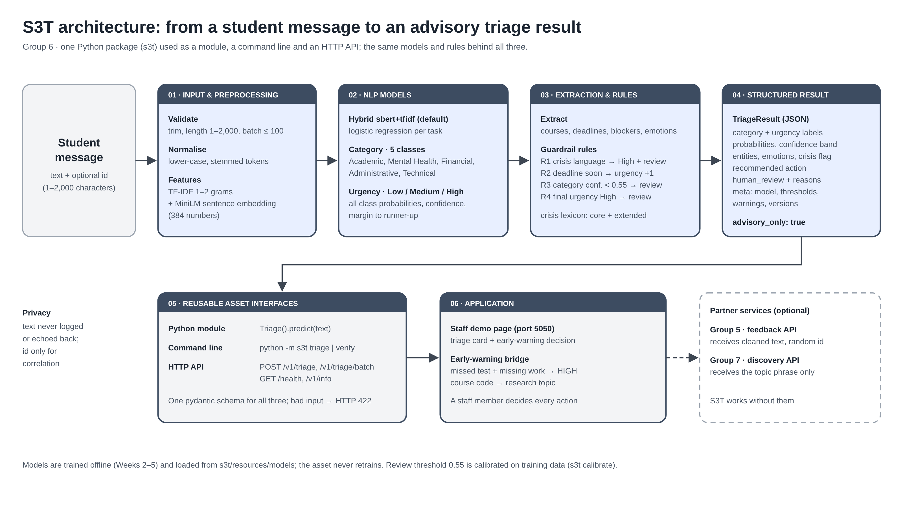

# S3T architecture

(Editable source: `architecture.svg`.)

| Layer | What happens | Code |
|---|---|---|
| 01 Input & preprocessing | Validate text (1–2,000 characters, batch ≤ 100); lower-case and Porter-stem; build TF-IDF (1–2 grams) and a MiniLM sentence embedding (384 numbers) | `s3t/schemas.py`, `s3t/preprocess.py` |
| 02 NLP models | Hybrid `sbert+tfidf` logistic regression per task: category (5 classes) and urgency (3 levels), with all class probabilities, top confidence and margin | `s3t/models.py`, `s3t/classifier.py` |
| 03 Extraction & rules | Regex extraction of courses, deadlines, blockers, emotions; crisis lexicon; rules R1 crisis → High + review, R2 imminent deadline → urgency +1, R3 category confidence < 0.55 → review, R4 final High → review | `s3t/extraction.py`, `s3t/rules.py` |
| 04 Structured result | `TriageResult`: labels, probabilities, confidence band, entities, emotions, crisis flag, recommended action, human review + reasons, meta (model, thresholds, warnings, versions), `advisory_only: true` | `s3t/schemas.py`, `s3t/triage.py` |
| 05 Interfaces | Python module `Triage().predict()`, command line `python -m s3t`, HTTP API `/v1/triage`, `/v1/triage/batch`, `/health`, `/v1/info` | `s3t/triage.py`, `s3t/cli.py`, `s3t/api.py` |
| 06 Application | Staff demo page with the early-warning bridge; optional partner services (Group 5, Group 7) over HTTP | `integration/` |

## Design decisions

1. **One contract, three interfaces.** The module, CLI and API share the same pydantic schema, so every caller
   gets the same validated JSON.
2. **No retraining in the asset.** It loads the Week 5 models; `s3t verify` checks they reproduce the Week 5
   numbers (21 of 21).
3. **Calibrated review threshold.** Category confidence below 0.55 (chosen by cross-validation on training
   data) sends the message to a person. Urgency confidence is not used as a trigger because it did not
   separate right from wrong answers.
4. **Safety rules override the model.** Crisis language always forces High urgency and human review.
5. **Privacy.** Message text is never logged or echoed back; the `id` is for correlation only.
6. **Partners are optional.** The bridge calls Group 5 and Group 7 only when they are configured and keeps
   working (and says so) when they are not.
