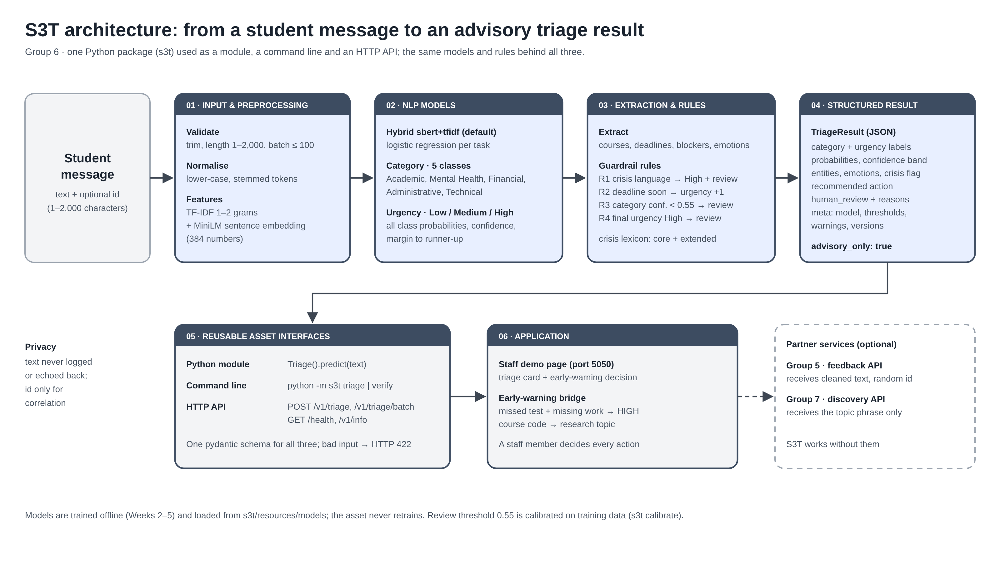

# Group 6 Final Report: S3T Student Support Triage

30 October 2026

## Summary

S3T (Student Support Triage) reads a message a student sends to student support and returns its category, its
urgency, confidence scores, the courses and deadlines it mentions, a recommended action and a human-review flag,
in under 10 ms. Our default hybrid model (SBERT + TF-IDF) reaches category macro-F1 0.859 and urgency macro-F1
0.794 on a held-out generated test set, and catches 98% of truly urgent messages. It is packaged as a Python
module, a command line and an HTTP API, and in Week 8 we added a staff demo page and an early-warning bridge to
other groups' components. The system is advisory only: a staff member reads every result.

## Problem and users

Student-support teams receive a mixed inbox: login problems, fee questions, transcript requests, students falling
behind, and occasionally a student in crisis. Sorting it by hand is slow, and an urgent message can sit unread
behind routine ones. S3T sorts each message into one of five teams (Academic Difficulty, Mental Health &
Wellbeing, Financial Aid, Administrative, Technical Support), rates its urgency, and flags the ones a person must
read first.

| User | What they get | What they decide |
|---|---|---|
| Student-support staff | Category, urgency, recommended route, review flag and reasons | Who handles the message and how fast |
| Wellbeing team | Every message with crisis language, marked High | Immediate personal follow-up |
| Other university components | The same result as JSON over the API | How to use it in their own workflow |

S3T is not for automatic replies, grading, discipline or any decision about a student without a person reading
the message.

## Data

All training and test data is generated; no real student messages were available.

| Set | Size | How it was built | Used for |
|---|---|---|---|
| Training | 1,170 messages | 60 template sentences, varied greetings/closings, ~4% labels flipped as noise | Training, threshold calibration |
| Test | 299 messages | 15 held-out template sentences | Main evaluation |
| Challenge | 30 messages | Written to break the model: Indian-university terms, Hinglish, negation, indirect crisis wording, out-of-scope | Robustness check |

Because the test set comes from 15 sentences, the 95% interval for category macro-F1 is 0.59 to 0.98.

## NLP approach

| Model | Features | Classifier | Category macro-F1 | Urgency macro-F1 |
|---|---|---|---|---|
| Baseline (Week 2) | Stemmed TF-IDF, 1–2 grams | Logistic regression / Naive Bayes | 0.588 | 0.751 |
| SBERT (Week 4) | all-MiniLM-L6-v2 embeddings (384) | Logistic regression | 0.880 | 0.602 |
| **Hybrid (default)** | Embeddings + TF-IDF | Logistic regression | **0.859** | **0.794** |

SBERT is strong on category but weak on urgency; adding the TF-IDF word features recovers urgency.
Around the models: regex extraction (courses, deadlines, blockers, emotions); a crisis lexicon (core + extended);
rules R1 crisis → High + review, R2 imminent deadline → urgency +1, R3 category confidence < 0.55 → review,
R4 final High → review; the 0.55 threshold was calibrated by grouped cross-validation on training data only.

## Architecture



Input and preprocessing → NLP models → extraction and rules → structured result → three interfaces (module, CLI,
HTTP API) → application (demo page, early-warning bridge, optional partner services). The asset never retrains,
and message text is never logged or echoed back.

## Results and final testing

| Hybrid model | Test (n = 299) | Challenge (n = 30) |
|---|---|---|
| Category accuracy / macro-F1 | 0.860 / 0.859 | 0.607 / 0.592 |
| Urgency accuracy / macro-F1 | 0.819 / 0.794 | 0.750 / 0.768 |
| High-urgency recall / precision | 0.981 / 0.515 | 0.900 / 0.643 |
| Flagged for human review | 47% | 63% |
| Silent category errors | 21 (7.0%) | 3 |

| Suite | Result |
|---|---|
| S3T pytest | 19 of 19 passed |
| `s3t verify` contract checks | 10 of 10 passed |
| `s3t verify` Week 5 regression | 21 of 21 passed |
| Integration tests | 19 passed, 1 skipped (needs partner code) |
| End-to-end scenarios | 26 of 28 on baseline; the 2 misses pass with the default hybrid |

Details: `TEST_REPORT.md`.

## Reusable asset and integration

| Interface | Call |
|---|---|
| Python module | `Triage().predict(text, id=...)`, `predict_batch(...)` |
| Command line | `python -m s3t triage | evaluate | calibrate | verify` |
| HTTP API | `POST /v1/triage`, `POST /v1/triage/batch`, `GET /health`, `GET /v1/info` |

The early-warning bridge flags a student as at risk (HIGH, MEDIUM or LOW) when the email mentions a missed test
and missing submissions, and maps the course to a research topic. When partner components are running it sends
the topic alone to Group 7 and a cleaned copy of the email (no student id) to Group 5. S3T works fully without
them. Early-warning flag on 31 synthetic emails: precision 1.00, recall 0.50.

## Limitations and future work

- No real student messages; challenge-set category accuracy is 0.61.
- Test set was used for design decisions in Weeks 4–6.
- High urgency over-predicted (precision 0.515) → 47% review rate.
- Crisis detection is a keyword list; no out-of-scope class; no negation handling.

Next: (1) collect and double-label 50–100 consented classmate messages; (2) reduce High over-prediction;
(3) wellbeing-staff review of the crisis list; (4) out-of-scope class and negation; (5) authentication, rate
limiting and audit logging before real use.

```
./run_demo.sh     # opens http://127.0.0.1:5050
./run_tests.sh    # all test suites
```
